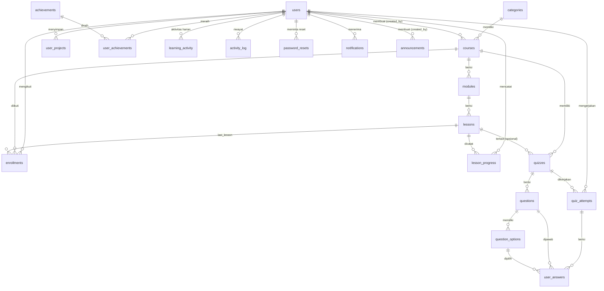

# Diagram Relasi Database CodeMif

## Penjelasan tabel

| Tabel | Fungsi |
|---|---|
| `categories` | Kategori kursus (Web Frontend, Backend, dst). |
| `users` | Akun: identitas, hash password, role (`user`/`admin`), status, preferensi, XP, level, streak. |
| `courses` | Kursus: kategori, level, bahasa, durasi, status aktif. |
| `modules` | Bagian dalam kursus, diurutkan `sort_order`. |
| `lessons` | Pelajaran: teori, contoh kode, penjelasan, latihan, tugas proyek, durasi, XP. |
| `enrollments` | Kursus yang diikuti user; satu user hanya sekali per kursus (UNIQUE). |
| `lesson_progress` | Status tiap pelajaran per user. Kolom `xp_awarded` mencegah XP ganda. |
| `quizzes` | Kuis milik kursus (opsional terkait pelajaran), nilai lulus, XP. |
| `questions` | Soal: pilihan ganda, benar/salah, melengkapi kode, debugging. |
| `question_options` | Pilihan jawaban dan penanda `is_correct` (hanya dibaca backend). |
| `quiz_attempts` | Satu baris per percobaan: skor, persentase, lulus, XP. |
| `user_answers` | Jawaban per soal dalam satu percobaan; dinilai oleh backend. |
| `user_projects` | Proyek HTML/CSS/JS yang disimpan dari playground. |
| `achievements` | Definisi badge dan kriterianya. |
| `user_achievements` | Badge yang sudah diraih user (UNIQUE per user-badge). |
| `learning_activity` | Ringkasan harian (menit, pelajaran, XP) untuk grafik mingguan dan streak. |
| `activity_log` | Riwayat aktivitas terakhir yang tampil di dashboard. |
| `password_resets` | Hash SHA-256 token reset, masa berlaku, status pemakaian. |
| `notifications` | Notifikasi per user. |
| `login_attempts` | Catatan percobaan login untuk pembatasan (rate limiting). |
| `announcements` | Pengumuman dari admin. |

## Aturan ON DELETE
- Data milik user (progres, jawaban, proyek, notifikasi) dihapus otomatis saat user dihapus (`CASCADE`), sehingga fitur hapus akun bersih.
- `courses.category_id` memakai `RESTRICT`: kategori yang masih dipakai tidak bisa dihapus.
- Kolom `created_by`, `last_lesson_id`, `quizzes.lesson_id`, dan `user_answers.option_id` memakai `SET NULL` agar riwayat tidak ikut hilang.
- Semua relasi memakai `ON UPDATE CASCADE`.
